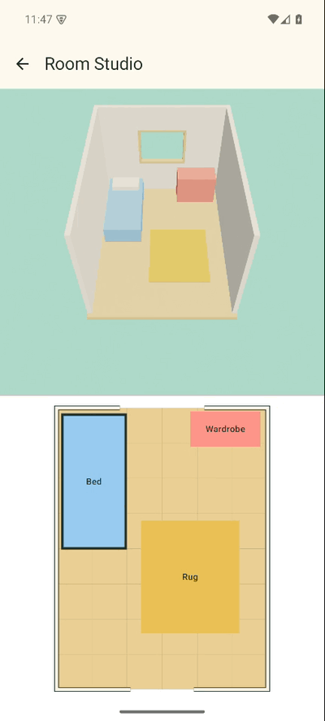
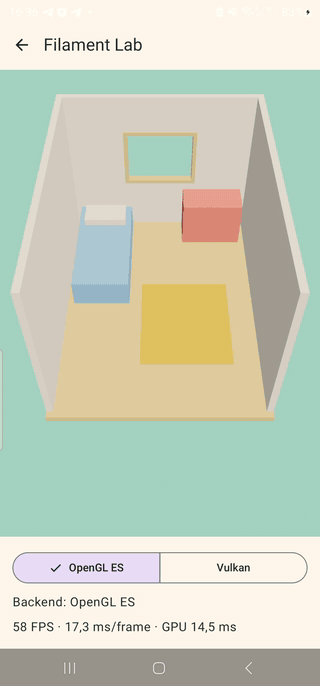

# 3DollHouse

An Android learning project for exploring real-time 3D rendering with
[Filament](https://github.com/google/filament), Google's physically based
renderer, inside a Jetpack Compose app. Open **Filament Lab** to explore a
furnished 3 × 4 m room and compare the OpenGL ES and Vulkan backends, or open
**Room Studio** to rearrange its furniture on a 2D floor plan and watch the 3D
room follow.

<p align="center">
  
</p>

## Requirements

- Android Studio with Android SDK Platform 37
- JDK 17
- A device or emulator running Android 8.0 (API 26) or newer.
  Vulkan needs a device with Vulkan support. Without it the app falls back to OpenGL ES.

## Build and run

```sh
./gradlew installDebug
```

Then launch **3DollHouse** and open **Filament Lab** or **Room Studio**.

## Filament Lab

<p align="center">
  
</p>

- **Drag to orbit, pinch to zoom.** Walls between the camera and the room hide automatically.
- **Switch between OpenGL ES and Vulkan.** The view keeps its camera angle and zoom.
  The status line shows the active backend, including any fallback to OpenGL ES.
- **Watch frame statistics.** FPS and ms/frame describe how often the scene redraws.
  GPU ms shows how long a recent frame took on the GPU, when available.

<details>
<summary><b>What I learned building Filament Lab</b></summary>

The project grew one commit at a time. Each step below is something I had to figure out.

1. **A surface to draw on.** `FilamentHost` owns the engine, the swap chain and the
   `Choreographer` frame loop. Scene setup lives behind a small `FilamentContent`
   contract, so surface handling stays separate from what is drawn.
2. **Materials are compiled ahead of time.** Android can't load a `.mat` file. `matc`
   compiles it into a `.filamat` with ready shaders for each graphics API.
   `matc` must match the Filament version of the app library, or the material won't load.
3. **Mesh vs material.** A mesh describes the shape, a material describes how the surface
   reacts to light. One material is shared by many objects, each with its own
   `MaterialInstance` (color, roughness). Destroy instances before their material,
   and everything before the engine.
4. **Native code needs direct buffers.** Assets and vertex data go through direct
   `ByteBuffer`s in the device's byte order. After `put()`, call `flip()`, otherwise Filament
   sees an empty buffer.
5. **A cube is 24 vertices, not 8.** Each face has its own corners and normal, so lighting
   doesn't smooth the edges. Triangles go counter-clockwise from outside, or
   back-face culling hides them.
6. **No lights, black cube.** A lit material renders black without lights. Filament uses
   physical units: with the default exposure the sun needs about 100,000 lux.
   A directional light has only a direction, and an `IndirectLight` fills the faces
   turned away from it.
7. **One mesh, many boxes.** A transform scales the unit cube to any size and moves it
   into place. Matrices are column-major, so the translation sits in elements 12-14.
   Non-uniform scale doesn't break lighting, Filament derives a separate matrix for normals.
8. **Orbit camera.** Yaw, pitch and distance around a fixed target define the camera
   position. Dragging updates the angles.
9. **Pinch zoom.** The pinch scale factor changes the distance, and limits keep the zoom
   in range.
10. **Surviving rotation.** `rememberSaveable` with a `listSaver` keeps the camera angles
    and distance when Android recreates the screen.
11. **Hiding walls.** The dot product of the wall normal and the direction to the camera
    tells which side the camera is on. A wall is hidden by taking it out of the scene
    without destroying its entities.
12. **Switching backends.** The engine is recreated for OpenGL ES or Vulkan, while the
    camera pose is preserved. The active backend is reported, including a fallback.
13. **Frame statistics.** FPS is measured from rendered frames. GPU time comes from
    Filament frame info when the driver provides it.

</details>

## Room Studio

Drag furniture on the 2D floor plan to move it in the 3D room as you drag.
Drag in the 3D view to orbit the room, or pinch to zoom. The room and plan
stack in portrait and sit side by side in landscape.

<p align="center">
  
</p>

<details>
<summary><b>How Room Studio was built</b></summary>

1. **Give the room one model.** `RoomLayout` describes dimensions, door and
   window openings, and furniture positions in meters. Both views use it.
2. **Group furniture in 3D.** The bed and pillow share a parent transform,
   so moving the parent moves both parts together.
3. **Draw the floor plan.** `PlanTransform` converts between room meters and
   Canvas pixels. Tests cover the round trip and fitting the plan in portrait
   and landscape.
4. **Add walls, openings, and furniture.** The Canvas and Filament views use
   the same room palette.
5. **Select and drag furniture.** A tap selects the topmost item under the
   finger. Dragging keeps the initial grab offset and clamps the item to the
   room bounds.
6. **Restore the layout after rotation.** `rememberSaveable` stores furniture
   IDs and their center coordinates.
7. **Bring 3D into Room Studio.** Extracting `FilamentSurface` lets both screens
   reuse it. Room Studio places it beside the plan in landscape and above it
   in portrait, with a camera position that survives rotation.
8. **Link the plan to the scene.** A drag updates `RoomLayout`. Filament applies
   the new positions to existing parent transforms while keeping the scene
   alive.

</details>

## Project layout

- `app/src/main/kotlin/com/dollhouse/lab/filament/` has the Filament code:
  `FilamentHost` owns the engine and render loop, `ToyRoomScene` builds the room,
  and `OrbitCamera` turns yaw, pitch and distance into a camera position.
  `FilamentLabScreen` is the Compose UI.
- `app/src/main/materials/` has the `.mat` material sources.
- `app/src/main/assets/materials/` has the compiled `.filamat` files the app loads.
- `tools/` has the material build script and the Filament command-line tools.

## Materials

Compiled `.filamat` files are included. Rebuild them after editing a `.mat`
source or updating Filament.

```sh
sh tools/build_materials.sh
```

The Filament tools in `tools/filament/bin` (`matc` and `matinfo`) are committed to
the repository and are for macOS arm64 only. On other platforms, use `matc` from the
same release as the Android library (1.80.1).
[Filament releases](https://github.com/google/filament/releases)

```sh
MATC=/path/to/filament/bin/matc sh tools/build_materials.sh
```

## License

Released under the [MIT License](LICENSE).

The bundled Filament tools in `tools/filament/bin` and the Filament library are
licensed under Apache-2.0 by Google.
